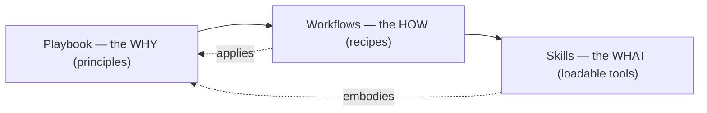

# agent-vault


*A harness for working with AI agents: the memory, loops, checks and skills around the model. Coding first, and now most of everything else.*

I build and ship production software with coding agents (Claude Code, Codex) as my main interface.
Over time the same agent took over most of the rest of my work too: my notes, my meetings, what I
learn, my deploys and DNS. This repo is the operating system behind that, written down so your
agent can use it too:

- **Skills your agent can load today:** turn a call recording into notes and tasks, keep a personal
  wiki that gets smarter with every source, deploy and manage DNS without opening a dashboard, run
  code changes through a plan → build → audit loop, and write your own skills.
- **The principles behind them,** each with a real receipt: what went wrong before the rule existed.
- **Honest limits:** every piece says how proven it is, and the mistakes are written down on purpose.

It all comes from real work on [Delphy](https://delphy.network),
[SUPERPOWERS](https://superpowers.network), [Summer AI](https://summerai.network) and
[fermartz.com](https://fermartz.com).

## Quick start

**1. Hand it to your agent** (easiest). Paste this, and edit the list:

```text
Read https://github.com/fermartz/agent-vault (README, then the skills I name).
Install these skills for me: meeting-to-notes, video-transcript, llm-wiki.
For each one, read its Requirements section, check what's already installed on my
machine, and tell me what's missing with the install command. Ask me before
installing anything. Then add the brevity block from playbook/human-context.md to
my CLAUDE.md (or AGENTS.md), and tell me how to try each skill once.
```

**2. Copy one skill yourself:**

```sh
git clone https://github.com/fermartz/agent-vault.git
mkdir -p ~/.claude/skills
cp -r agent-vault/skills/meeting-to-notes agent-vault/skills/video-transcript ~/.claude/skills/
```

**3. Adopt the whole loop for code:** read [The Blueprint](./workflows/the-blueprint.md), then
load [`skills/blueprint`](./skills/blueprint/SKILL.md).

Codex, other agents, requirements per skill, and customizing:
**[docs/getting-started.md](./docs/getting-started.md)**.

## What's inside

### Skills: the *what*

| For | Skill | What it does |
|---|---|---|
| **Building code** | [blueprint](./skills/blueprint/SKILL.md) | Plan → build → verify → audit by a second agent; ceremony sized S/M/L/XL |
| | [code-review](./skills/code-review/SKILL.md) | Adversarial review of a diff: APPROVED or REQUEST_CHANGES with findings |
| | [cross-artifact-sweep](./skills/cross-artifact-sweep/SKILL.md) | After a fix, sync docs and memory with the code so review loops stay short |
| | [agent-init](./skills/agent-init/SKILL.md) | Set up the `.agent/` working-memory folder and the first source map |
| | [public-repo-audit](./skills/public-repo-audit/SKILL.md) | Read a whole repo like a skeptical senior engineer before you share it |
| **Notes and knowledge** | [llm-wiki](./skills/llm-wiki/SKILL.md) | A markdown + git wiki the agent maintains: ingest, query, lint |
| | [meeting-to-notes](./skills/meeting-to-notes/SKILL.md) | Call recording → local transcript kept as evidence → notes, tasks, open loops |
| | [video-transcript](./skills/video-transcript/SKILL.md) | The spoken text of a social video or audio file, locally, plus what it actually claims |
| | [teach-in-bites](./skills/teach-in-bites/SKILL.md) | Learn anything one bite at a time, at your pace, then keep the lesson |
| **Operations** | [agent-deploy](./skills/agent-deploy/SKILL.md) | Deploys, env vars, domains and DNS on Vercel + Cloudflare, with a human yes before anything billable or public |
| **Making skills** | [skill-builder](./skills/skill-builder/SKILL.md) | Turn a workflow into a shareable skill; a guided interview if you start from an idea |

### Workflows: the *how*

- **[The Blueprint](./workflows/the-blueprint.md)**: one agent builds, a different agent audits, and
  big changes don't ship until the audit approves (by default; the audit is a switch, see below). Change levels keep a typo from getting the full
  loop.
- **[The LLM Wiki](./workflows/llm-wiki.md)**: raw sources in, a growing web of linked pages out.
  Each source is folded into every page it affects when it arrives, so answers get richer over time.

### Playbook: the *why*

| Principle | In one line |
|---|---|
| [Give the Agent a Memory](./playbook/memory-system.md) | Durable knowledge belongs in files, not the chat |
| [A Plan Is a Contract, Not a Spec](./playbook/plan-build-review.md) | Plan the *what* and *why*; leave *how* to the code |
| [Don't Grade Your Own Homework](./playbook/adversarial-verification.md) | The agent that built it is the wrong one to judge it |
| [Protect the Context](./playbook/context-hygiene.md) | An agent reasons best with a small, relevant window |
| [Protect the Human's Context](./playbook/human-context.md) | Your attention is a window too: short by default, deep on request |
| [Synthesize When You Write](./playbook/write-time-synthesis.md) | Fold each source in when it arrives, so knowledge compounds |
| [Hand Over Keys, Not the Keyring](./playbook/least-privilege.md) | Scoped access, secrets never through the agent, ask before money or anything public |

Plus one convention: [keep the agent's brain in one folder](./playbook/the-agent-folder.md) (`.agent/`).



Every workflow cites the principles it applies and the skills it uses; every skill points back to
the principle behind it. Enter from any side.

## The audit is your call

The second-agent audit is my strongest habit and my default, but it costs tokens and time, so it's
a switch. One line in your `CLAUDE.md` / `AGENTS.md`:

- **`Audit: auto`** (default): simple changes skip it, features and risky changes get it.
- **`Audit: always`**: every change.
- **`Audit: off`**: none. Things can still turn out fine; you just lose the second pair of eyes.

Or per change: "skip the audit" / "audit this one", which beats the setting either way. The agent
never turns it off by itself, and it logs every audit it skips that the setting would have run. **Why I keep it on:** a building model once graded its own work "B+, ready to
ship", and a second agent found real bugs in the same diff. Writing this repo's own skills, audits
caught three bugs in what looked like a documentation move, and advice that could have leaked
secrets. Details: [the audit switch](./workflows/the-blueprint.md#your-call-the-audit-switch).

## Works with

Written for Claude Code and Codex, and usable by any agent that reads markdown: the skills are plain
`SKILL.md` files, and the workflows are documents an agent can follow. Skills that need tools
(Python, ffmpeg, a CLI) list them, check before running, and ask before installing anything.
macOS and Linux are covered; on Windows, use WSL (native Windows commands are in the docs, untested).

## How proven is each piece

- **battle-tested**: used repeatedly on shipped work
- **working**: the practice has run for weeks; the written form is newer
- **experimental**: promising, still shaking out

Each skill, workflow and principle says which one it is.

## Status

Growing in public: seven principles plus the `.agent/` convention, two workflows and eleven skills
today, more added piece by piece, the same way I build everything.

## About

Built by **Fer Martz**, an engineer building production AI products: agents, the agentic web, and
the tooling that drives them. [fermartz.com](https://fermartz.com) ·
[github.com/fermartz](https://github.com/fermartz) ·
[LinkedIn](https://linkedin.com/in/fernando-martinez-valdez)

## License

MIT. Use anything here. If it saves you a review round, that's the point.
