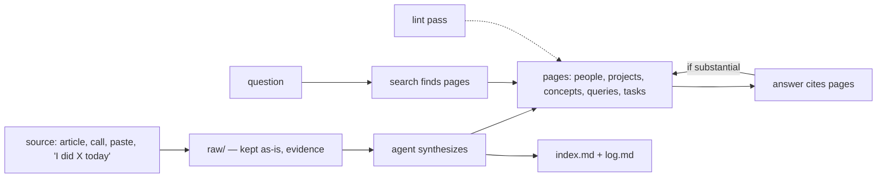

# The LLM Wiki

*Raw sources in, a growing web of linked pages out. The agent keeps it; you read it.*

Plain markdown in a git repo, maintained by an agent. You bring sources: articles, papers, meeting
recordings, research, and plain self-reports ("I shipped X today", "the client agreed to Y"). The
agent files each one as evidence, then folds it into the pages it affects. You read the result in
any markdown reader. The pattern comes from Andrej Karpathy's LLM-wiki idea; this is how I run it
every day.

> **Want your agent to just *run* this?** Load the executable twin:
> [`skills/llm-wiki`](../skills/llm-wiki/SKILL.md). This page is the *why*; the skill is the *do-this*.

## When to use this

- You keep re-explaining the same context to agents across sessions.
- Your knowledge lives in chats, voice notes and tabs, and none of it connects.
- You want answers that get better over time, not answers that are only as good as the last search.

Not for: a single project's code memory. That's the [`.agent/` folder](../playbook/the-agent-folder.md).

## The shape

| Layer | What lives there | Rule |
|---|---|---|
| **Raw** (`raw/`) | Sources exactly as they came, with provenance (URL, date, author) | Create, or append to today's journal. Never rewrite. |
| **Pages** | One page per entity, concept, comparison, filed answer, or open task | Synthesized, linked, dated, and they cite their raw sources |
| **Navigation** | `index.md` (every page, one line each) and `log.md` (every change, one line each) | Updated on every operation |
| **Schema** | `SCHEMA.md`: page types, frontmatter, tags, link style, lint checks | Changes go through a plan and a review, like code |

## The three operations

### Ingest

1. **Capture the raw source.** External sources get a file with provenance frontmatter. Self-reports
   go into today's journal file as a timestamped entry that links every person and project it's about.
2. **Discuss the takeaways briefly** and confirm before writing pages
   ([Protect the Human's Context](../playbook/human-context.md)).
3. **Find every page it touches.** The index first, then search. Meaning search catches pages named
   differently from the words in the source.
4. **Create or update pages.** New page only on evidence (2+ sources, or the source is about it).
   Add links both ways. Cite the raw file. Bump `updated:`.
5. **Hub sweep.** If a person or project changed state, update the hub pages that summarize them
   (a "now" page, the owner's page) in the same pass.
6. **Index, log, commit.** One index line per new page, one log line per changed file, a commit with
   an explicit file list, then refresh the search index.

### Query

1. Index → search → open the pages. **Search finds; the page is the truth.** Never cite a snippet.
2. Answer with the page each claim came from.
3. **File it** only if it's substantial (touches several pages, makes a new comparison, or is worth
   rereading). A good answer filed as a page becomes a source for the next question.

### Lint

A read-only pass that reports, never fixes: broken links, filename ≠ slug, missing frontmatter,
tags outside the list, orphan pages, index drift, stale tasks, active projects and the status page
gone stale, contradictions to review. You pick which findings to act on.

## Standing rules (so you never repeat yourself)

The agent does these without being asked:

- **Stated facts and decisions** go to the journal and the affected pages in the same turn.
- **Research is always filed** the moment it returns, never left in the chat.
- **Open loops become task pages:** anything waiting on someone, or owed by you, with a status and
  a date. Done tasks are archived after two weeks.
- **New page ⇒ backlinks.** Every new page gets linked from the pages it relates to, before the
  commit.

## Search: cheapest first

1. Exact names, IDs, numbers → `grep`. Milliseconds.
2. Normal questions → a local hybrid search (keywords + meaning + rerank), e.g.
   [qmd](https://github.com/tobi/qmd). Write the keyword and meaning queries yourself instead of
   letting the tool expand them.
3. Only escalate when the top hit is weak.
4. Open the page before citing it.

## Failure modes

> **Failure mode: the chat becomes the wiki.** A long research answer stays in the scrollback and
> dies with the session. Fix: the standing rule. Research is filed when it returns.

> **Failure mode: the one-page ingest.** A source updates one page and misses the four it also
> affects. Fix: step 3, and the hub sweep. A meeting that changed a price, a deadline and a person's
> role touches at least three pages.

> **Failure mode: rewriting the evidence.** "Cleaning up" a transcript erases what was actually
> said. Fix: mishearings go in the raw file's header; the body is never edited.

> **Failure mode: stale hubs.** The status page says a project is active a month after it stopped.
> Fix: the hub sweep on every state change, and lint checks for active projects untouched for 14
> days and a status page older than the newest page.

## Getting started

Start from the skill's [starter schema](../skills/llm-wiki/references/starter-schema.md): `raw/` for
evidence, one folder per page type (`entities/`, `concepts/`, `comparisons/`, `queries/`,
`summaries/`, `tasks/`), `_archive/`, the files `index.md`, `log.md` and `SCHEMA.md`, and an
instruction file telling the agent to follow the schema. Add page types,
tags and lint checks only when you feel their absence: the schema here reached version 7 by growing
from real friction, not by being designed up front.
